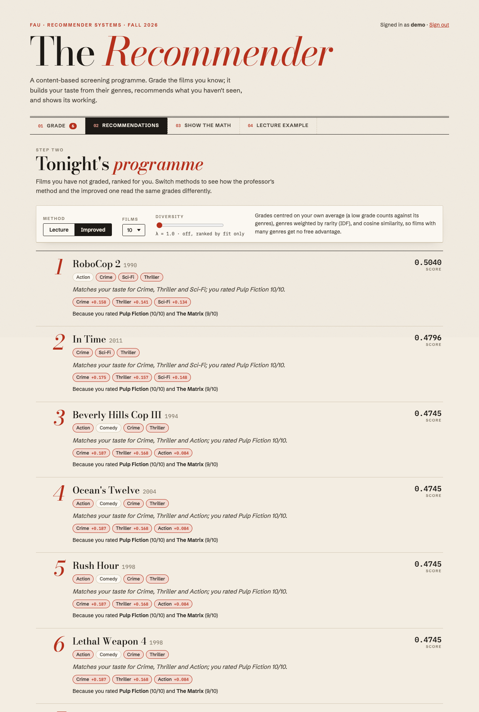
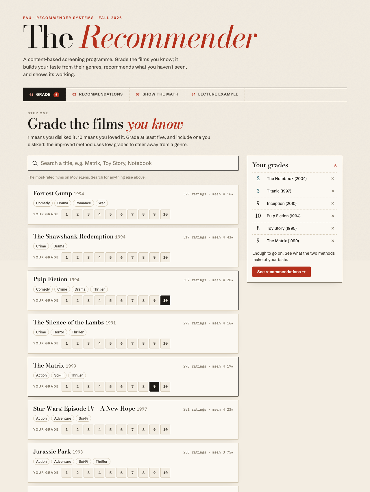
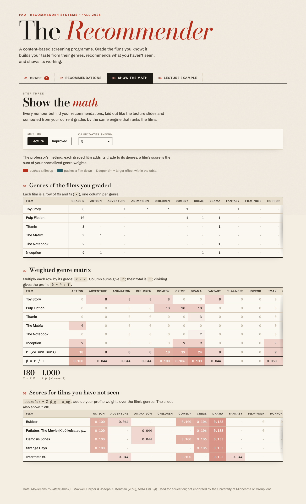
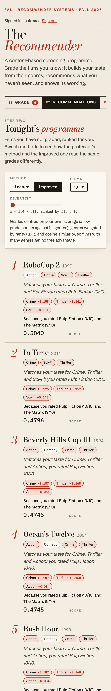
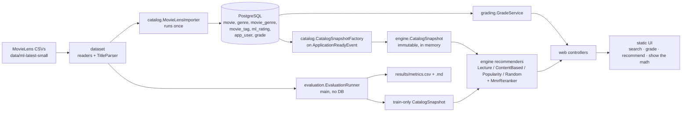

# Explainable Movie Recommender

[](https://github.com/Aryankanani1/explainable-movie-recommender/actions/workflows/ci.yml)

A content-based movie recommender built with Java and Spring Boot on the MovieLens dataset. You grade movies you know; it builds a taste profile from their genres and tags, recommends films you haven't seen, and explains each pick. It can also show the full matrix calculation behind a recommendation.

**Live demo:** _coming soon_ (free hosting: the first visit after a quiet spell takes about a minute to wake the app).

> Course project for Recommender Systems, Florida Atlantic University (Prof. Borko Furht), Fall 2026.



| Grade movies | Show the math | On a phone |
|---|---|---|
|  |  |  |

## How it works

**The lecture method**, reproduced exactly from the course slides. Grades: Batman v Superman 2, Guardians of the Galaxy 10, Captain America: Civil War 8.

1. Weight each graded film's genre row by its grade and sum the columns: P = Comedy 18, Adventure 12, Super Hero 20, Sci-Fi 10, Drama 0, so T = Σ P = 60.
2. Normalise to the taste profile p̂ = P / T = (0.300, 0.200, 0.333, 0.167, 0).
3. Score each unseen film by adding up p̂ over its genres: The Hitchhiker's Guide to the Galaxy 0.667, Spider-Man 0.633, Batman Begins 0.333, Lady Bird 0.

The app's **Lecture example** page computes these numbers live, and **Show the math** draws the same matrices for your own grades. [`report-assets/calculations.md`](report-assets/calculations.md) has them in full.

**The improved method** fixes the lecture method's weaknesses: grades are centred on your own average (so a low grade pushes its genres *down*), genres are weighted by IDF (so common genres such as Drama count less), and candidates are ranked by cosine similarity. A tag block (MovieLens user tags, TF-IDF) is implemented but off in the app (β = 0), because it lowered accuracy in the evaluation. An optional MMR re-ranking (the diversity slider) makes the list more varied.

**Every recommendation is explained**: the genres that contributed most and the graded film that influenced it most ("Matches your taste for Crime, Thriller and Mystery; you rated Pulp Fiction 10/10").



The engine is plain Java with no Spring or database code, so the web app and the offline evaluation run exactly the same recommender classes.

## Results

Offline evaluation on MovieLens ml-latest-small: 610 users, 9742 movies, 100836 ratings. Per user, a seeded 80/20 split (new Random(42 + userId)); a hidden movie is relevant when rated ≥ 4.0; K = 10. Popularity counts come from train ratings only.

| Method | Users | Skipped | P@10 | R@10 | NDCG@10 | HR@10 | Coverage | ILD | Novelty |
|---|---:|---:|---:|---:|---:|---:|---:|---:|---:|
| random | 602 | 8 | 0.0018 | 0.0011 | 0.0023 | 0.0183 | 0.4691 | 0.7616 | 7.18 |
| popularity | 602 | 8 | 0.1201 | 0.0989 | 0.1590 | 0.5664 | 0.0060 | 0.6940 | 1.66 |
| lecture | 602 | 8 | 0.0050 | 0.0039 | 0.0055 | 0.0465 | 0.0204 | 0.3016 | 7.07 |
| cb-cosine | 602 | 8 | 0.0150 | 0.0129 | 0.0183 | 0.1179 | 0.0773 | 0.1091 | 5.83 |
| cb-centered | 602 | 8 | 0.0249 | 0.0137 | 0.0333 | 0.1645 | 0.2206 | 0.0692 | 5.17 |
| cb-idf | 602 | 8 | 0.0239 | 0.0124 | 0.0318 | 0.1611 | 0.2231 | 0.0931 | 5.39 |
| cb-idf-mmr | 602 | 8 | 0.0244 | 0.0125 | 0.0320 | 0.1661 | 0.2210 | 0.1030 | 5.37 |
| cb-tags | 602 | 8 | 0.0118 | 0.0062 | 0.0152 | 0.0980 | 0.2135 | 0.0970 | 5.90 |
| cb-tags-tuned | 602 | 8 | 0.0239 | 0.0124 | 0.0318 | 0.1611 | 0.2231 | 0.0931 | 5.39 |
| cb-tags-mmr | 602 | 8 | 0.0120 | 0.0063 | 0.0152 | 0.0997 | 0.2115 | 0.1074 | 5.87 |
| cb-tags-pop | 602 | 8 | 0.0204 | 0.0143 | 0.0243 | 0.1711 | 0.1850 | 0.1296 | 4.96 |

Popularity is by far the most accurate method here (NDCG@10 0.159 against 0.032 for the improved method), but it recommends from 0.6% of the catalogue and its picks are the least novel. Each fix to the lecture method helps: cosine similarity and centring raise NDCG@10 from 0.0055 to 0.0333, and the improved method beats the lecture method with a 95% bootstrap interval that excludes zero, while covering about ten times more of the catalogue. IDF weighting does not change accuracy measurably but makes the lists more varied, and user tags at β = 0.5 lowered NDCG@10, so the validation search set β = 0. Genres alone are a weak signal for which films a person rates highly; the content-based method's strengths are its explanations and its reach into the long tail. Details, the β search and the bootstrap tests are in [`results/metrics.md`](results/metrics.md).

## Run, test and evaluate

**Full stack in Docker** (just Docker needed):
```bash
docker compose up --build   # app on http://localhost:8080, demo / demo account; first start imports MovieLens
```

**Development** (JDK 21 and Docker for PostgreSQL):
```bash
./mvnw spring-boot:run      # starts only Postgres (host port 5433), migrates and imports MovieLens on first start
./mvnw verify               # all tests; the integration tests use Testcontainers
```
For trying it out, `application.yaml` seeds a `demo` / `demo` account (`recsys.demo-user.enabled`); public deployments turn it off.

**Offline evaluation and report assets** (no database needed):
```bash
./mvnw -q compile exec:java                                                               # writes results/
./mvnw -q compile exec:java -Dexec.mainClass=edu.fau.recsys.evaluation.ReportAssetsRunner # writes report-assets/
```

**Smoke test** of a running app, local or deployed (registers a throwaway account): `node scripts/smoke-test.mjs http://localhost:8080`

## Deployment

The live demo runs on [Render](https://render.com) (free web service, from `render.yaml` and the `Dockerfile`) with a free [Neon](https://neon.com) PostgreSQL database. Configuration comes only from environment variables: `SPRING_DATASOURCE_URL`, `SPRING_DATASOURCE_USERNAME`, `SPRING_DATASOURCE_PASSWORD` (entered in Render's dashboard) and `RECSYS_DEMO_USER_ENABLED=false`. The free instance sleeps after 15 idle minutes; the next visit waits about a minute while it wakes up, and the very first boot also imports MovieLens into the empty database.

## Data
This project uses the MovieLens `ml-latest-small` dataset (100,836 ratings and 3,683 tag applications across 9,742 movies, by 610 users), redistributed in `data/ml-latest-small/` under its original license (see the README in that folder). The data is used for research and education only, not for commercial use. This project is not endorsed by the University of Minnesota or GroupLens.

> F. Maxwell Harper and Joseph A. Konstan. 2015. The MovieLens Datasets: History and Context. *ACM Transactions on Interactive Intelligent Systems (TiiS)* 5, 4: 19:1–19:19. https://doi.org/10.1145/2827872

## AI assistance
Development used AI assistance (Anthropic's Claude) for architecture review, code review, test design and teaching. The author wrote and can explain the recommendation engine and evaluation code.

## License
Code: [MIT](LICENSE). Data: MovieLens license (see above).
